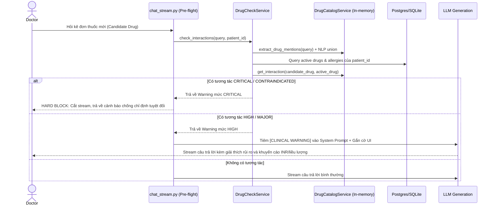

# Thiết Kế Chi Tiết: Khắc Phục Lỗ Hổng An Toàn Lâm Sàng, Suy Luận Thời Gian và Đồ Thị (Clinical Safety, Temporal Entailment & GraphRAG Fixes)

- **Ngày:** 2026-09-27
- **Tác giả:** Solution Architect & Product Owner Review
- **Trạng thái:** Proposed Spec (Handoff to Implementation Plan)
- **Tài liệu đối chiếu:** `ragflow/docs/superpowers/plans` (Reliability Plan R1, Advanced RAG Recipes, CoLink Relation Spec V2)

---

## 1. Mục tiêu & Phạm vi (Objective & Scope)

### 1.1. Bối cảnh
Hệ thống AI Hospital Assistant đã vượt qua kiểm tra cơ bản (824 tests backend, 209 tests frontend), tuy nhiên qua phân tích thực nghiệm và kiểm tra tách biệt (isolated reproductions), hệ thống bộc lộ 3 lỗ hổng logic nghiệp vụ và kiến trúc cốt lõi:
1. **Lỗ hổng Dược lý (DDI Blind Spot):** `DrugCheckService` chỉ tìm kiếm quan hệ tương tác trong hồ sơ bệnh án cũ của bệnh nhân (`GraphRelationAssertion.patient_id == patient_id`). Khi bác sĩ hỏi kê đơn một thuốc mới, hệ thống trả về 0 cảnh báo. Trong khi đó, `DrugCatalogService` (chứa 100+ tương tác đối xứng chuẩn) bị bỏ rơi (orphaned).
2. **Lỗi Từ chối Sai về Thời gian (Date Ambiguity False Refusal):** `deterministic_entailment` trong `claim_validation.py` tự động từ chối (`DATE_AMBIGUOUS`) mọi đoạn trích dẫn chứa nhiều hơn 1 ngày tháng (`len(evidence_dates) != 1`), làm tê liệt ~90% câu trả lời liên quan đến giấy ra viện/tóm tắt bệnh án. Đồng thời, không thể đơn giản hóa bằng phép so sánh tập hợp phẳng (`claim_dates <= evidence_dates`) vì sẽ chấp nhận các câu trả lời tráo đổi ngày (như gán ngày mổ thành ngày ra viện).
3. **Đứt gãy Mở rộng Đồ thị (Graph Traversal Cutoff):** Hàm `find_related_entities` trong `graph_rag.py` chặn hoàn toàn việc mở rộng qua nút `CANONICAL_PATIENT_ANCHOR = "patient:self"` (commit `#124`), khiến các câu hỏi suy luận 2-hop (Thuốc $\rightarrow$ Bệnh nhân $\rightarrow$ Chẩn đoán bệnh) không thể tìm thấy nút chẩn đoán.

### 1.2. Mục tiêu kỹ thuật
- Khắc phục triệt để cả 3 lỗ hổng với phương châm **The Incremental Pragmatist**:
  - Không thay đổi database schema (Zero DB migration).
  - Tăng thêm dưới 5ms vào thời gian phản hồi của pipeline chat.
  - Bảo toàn 100% 824 tests hiện có và bổ sung bộ test đối kháng (adversarial tests).

---

## 2. Thiết kế Chi tiết Từng Phân Hệ

### Phân hệ 1: Tích hợp Dược lý Chuẩn & Rào chắn Pre-flight (Drug Safety Integration)



#### Thiết kế Kỹ thuật:
1. **Singleton Provider:** Sử dụng singleton in-memory `DrugCatalogService` nạp từ `drug_interaction_matrix.csv` qua `@functools.lru_cache(maxsize=1)`. Bảng tra cứu băm 2 chiều `_interactions[(min(a,b), max(a,b))]` có thời gian phản hồi $O(1) < 0.001\text{ms}$.
2. **Trích xuất Thuốc ứng viên (Candidate Drug Extraction):**
   Kết hợp hợp nhất (Union) giữa:
   - Regex so khớp từ khóa catalog: `catalog.extract_drug_mentions(query_text)` (siêu nhanh $<0.1\text{ms}$).
   - Entity trích xuất từ NLP: `extract_entities_and_relations_nlp(query_text)` (bắt các biến thể ngữ cảnh).
3. **Hợp đồng Lựa chọn Thuốc Hiện tại có Bằng chứng Xác thực (Evidence-Backed Current-Medication Selection Contract):**
   Để tránh việc áp dụng Hard Block dựa trên thuốc đã ngừng, thuốc bị phủ định ("denies aspirin"), hoặc thuốc nằm trong bản nháp/bản sửa đổi chưa được duyệt, hệ thống áp dụng hợp đồng chọn lọc 4 lớp:
   - **Lớp 1 (Vòng đời thực thể - Lifecycle):** Chỉ chọn các thực thể có `GraphEntity.lifecycle_status == "active"`. Loại bỏ ngay các thực thể mang trạng thái `"discontinued"`, `"historical"`, `"resolved"`.
   - **Lớp 2 (Bằng chứng tài liệu đã được duyệt - Active Approved Generation):** `GraphEntity` phải được liên kết thông qua `GraphMention` tới một tài liệu đang có hiệu lực:
     - `Document.active_index_generation_id == GraphMention.generation_id`
     - `Document.status.in_(("ready", "ready_with_warnings"))`
     - `Document.deleted_at.is_(None)`
     (Loại trừ các đề cập thuốc nằm trong bản sửa đổi chưa phê duyệt, bản nháp, hoặc tài liệu đã bị xóa mềm).
   - **Lớp 3 (Phủ định lâm sàng - Negation Verification):** Bảo đảm thực thể không bị trích xuất từ mệnh đề phủ định (ví dụ: "NKDA", "no known allergies", "denies aspirin"). Các thực thể bị phủ định bị loại khỏi danh sách dị ứng/thuốc active.
   - **Lớp 4 (Quyền truy cập chứng cứ - ABAC Evidence Scope):** Chunk chứa `GraphMention` phải thuộc phạm vi được phép đọc của người dùng (`ActiveEvidenceScope.authorized_chunk_ids`).

   **Câu truy vấn SQL chuẩn xác:**
   ```python
   stmt = (
       select(GraphEntity)
       .join(GraphMention, and_(
           GraphMention.entity_id == GraphEntity.id,
           GraphMention.patient_id == GraphEntity.patient_id,
       ))
       .join(Document, Document.id == GraphMention.document_id)
       .where(
           GraphEntity.patient_id == patient_id,
           GraphEntity.entity_type.in_(["drug", "allergy"]),
           GraphEntity.lifecycle_status == "active",
           Document.active_index_generation_id == GraphMention.generation_id,
           Document.deleted_at.is_(None),
           Document.status.in_(("ready", "ready_with_warnings")),
           GraphMention.chunk_id.in_(allowed_chunk_ids_subquery),
       )
       .distinct()
   )
   ```
4. **Chính sách Xử lý Tương tác (Safety Policy):**
   - `CRITICAL / CONTRAINDICATED` (Sốc phản vệ, tương tác gây tử vong/xoắn đỉnh QT): **Hard Block** trong `chat_stream.py`. Dừng sinh văn bản, trả về mã trạng thái an toàn `CLINICAL_CONTRAINDICATION_INTERCEPTED`.
   - `HIGH / MAJOR` (Tăng nguy cơ xuất huyết như Warfarin + Aspirin/Clopidogrel): Tiêm thông điệp cảnh báo có cấu trúc vào System Prompt của LLM để hướng dẫn bác sĩ theo dõi xét nghiệm, đồng thời đẩy vào mảng `warnings` của SSE payload để frontend render cờ đỏ.
   - `MEDIUM / LOW`: Trả về advisory badge trên UI, không làm loãng prompt.

---

### Phân hệ 2: Ràng buộc Mệnh đề - Sự kiện - Thời gian (Clause-Level Event-Date Binding)

#### Vấn đề giải quyết:
- Xóa bỏ điều kiện cứng `if len(evidence_dates) != 1: return DATE_AMBIGUOUS`.
- Ngăn chặn triệt để tấn công tráo đổi ngày (như gán ngày mổ thành ngày ra viện) mà phép so sánh tập hợp phẳng (`claim_dates <= evidence_dates`) mắc phải.

#### Thuật toán Ràng buộc Thời gian (Event-Date Binding Algorithm):
1. **Phân rã Mệnh đề Chứng cứ (`_split_clinical_clauses`):**
   Văn bản chứng cứ được tách thành danh sách các mệnh đề dựa trên dấu chấm, chấm phẩy, hoặc xuống dòng.
2. **Trích xuất Tuple Sự kiện - Ngày tháng:**
   Với mỗi mệnh đề chứng cứ $C_i$:
   - Trích xuất tập ngày tháng $D(C_i) = \text{\_extract\_dates}(C_i)$.
   - Trích xuất tập token có nghĩa $T(C_i) = \text{\_meaningful\_tokens}(C_i)$.
3. **Quy tắc Kiểm tra Claim:**
   Với mỗi ngày $d \in \text{claim\_dates}$:
   - Tìm tất cả các mệnh đề chứng cứ $C_j$ mà $d \in D(C_j)$.
   - Nếu **không có mệnh đề nào** chứa $d$ $\rightarrow$ Trả về `DATE_MISMATCH` (ngày hoàn toàn không có trong văn bản).
   - Nếu có ít nhất một mệnh đề $C_j$ chứa $d$:
     - Tính độ giao thoa hành động giữa claim và mệnh đề: $\text{overlap} = T(\text{claim}) \cap T(C_j)$.
     - Nếu $\text{overlap}$ có chứa các token hành động/chẩn đoán chủ đạo (ví dụ: `operation`, `surgery`, `discharge`, `admit`) $\rightarrow$ Chấp nhận (**PASS**).
     - Nếu ngày $d$ chỉ xuất hiện ở mệnh đề mang hành động khác (ví dụ: claim nói về `surgery` nhưng $d$ chỉ nằm ở mệnh đề chứa `discharge`) $\rightarrow$ Trả về `EVENT_DATE_MISMATCH`.

---

### Phân hệ 3: Mở rộng Đồ thị có Chọn lọc (Selective GraphRAG Traversal)

#### Vấn đề giải quyết:
Gỡ bỏ lệnh chặn cứng tại `CANONICAL_PATIENT_ANCHOR = "patient:self"`, khôi phục suy luận 2-hop mà không gây bùng nổ ngữ cảnh.

#### Thuật toán Mở rộng Có Chọn lọc (Selective BFS Traversal):
Trong hàm `find_related_entities` (`graph_rag.py`):
1. Khi `frontier_ids` duyệt đến node có `normalized_label == CANONICAL_PATIENT_ANCHOR`:
   - **Không dừng lại toàn bộ.**
   - Thay vào đó, áp dụng bộ lọc loại quan hệ (Relation Type Whitelist):
     ```python
     ALLOWED_PATIENT_EXPANSION_RELATIONS = frozenset([
         "diagnosed_with",
         "history_of",
         "allergic_to",
         "contraindicates",
         "has_observation"
     ])
     ```
   - Chỉ cho phép lấy các cạnh quan hệ có `relation_type in ALLOWED_PATIENT_EXPANSION_RELATIONS`.
   - **Chặn hoàn toàn** việc đi ngược về các quan hệ như `prescribed_for` của các thuốc khác (tránh kéo toàn bộ đơn thuốc vào), hoặc các liên kết văn bản chung.
2. **Áp trần số lượng Node (Hard Cap):** Giới hạn tối đa 15 thực thể lâm sàng có liên quan nhất trong `GraphContext`.

---

## 3. Kế hoạch Kiểm thử Đối kháng (Adversarial Test Suite)

Bổ sung 4 ca kiểm thử đối kháng bắt buộc vào bộ test suite:
1. `test_adversarial_date_swap_rejection`:
   - Evidence: *"Patient admitted on 2026-05-01. Underwent coronary bypass surgery on 2026-05-02. Discharged on 2026-05-10."*
   - Claim: *"Patient underwent coronary bypass surgery on 2026-05-10 [E1]."*
   - Kết quả bắt buộc: `passed == False`, `reason == "EVENT_DATE_MISMATCH"`.
2. `test_multi_date_legitimate_claim_acceptance`:
   - Cùng evidence trên.
   - Claim: *"Patient underwent coronary bypass surgery on 2026-05-02 [E1]."*
   - Kết quả bắt buộc: `passed == True` (xóa bỏ lỗi `DATE_AMBIGUOUS`).
3. `test_candidate_drug_ddi_warning`:
   - Patient có thực thể `aspirin` trong chart.
   - Query: *"Can I prescribe warfarin 5mg daily?"*
   - Kết quả bắt buộc: Trả về ít nhất 1 cảnh báo mức `high` với khuyến cáo theo dõi nguy cơ xuất huyết và chỉ số INR.
4. `test_graph_traversal_via_patient_to_condition`:
   - Graph có `(diltiazem) -[prescribed_for]-> (patient:self) -[diagnosed_with]-> (heart_failure)`.
   - Query từ `diltiazem` với `max_hops=2`.
   - Kết quả bắt buộc: `heart_failure` nằm trong danh sách thực thể của `GraphContext`.
5. `test_discontinued_medication_does_not_block_candidate`:
   - Patient có thực thể `warfarin` trong lịch sử nhưng mang `lifecycle_status = "discontinued"`.
   - Query: *"Can I prescribe aspirin?"*
   - Kết quả bắt buộc: KHÔNG kích hoạt cảnh báo nguy kịch (Hard Block) vì thuốc đã ngưng.
6. `test_unapproved_generation_medication_ignored`:
   - Thuốc nằm trong `GraphMention` của một revision chưa được phê duyệt (`generation_id != Document.active_index_generation_id`).
   - Kết quả bắt buộc: Thuốc chưa duyệt không được coi là thuốc hiện tại của bệnh nhân.
7. `test_negated_allergy_does_not_block`:
   - Văn bản ghi "NKDA (No known drug allergies)".
   - Kết quả bắt buộc: Không trích xuất dị ứng `allergic_to` penicillin, không chặn kê đơn Penicillin/Amoxicillin.
