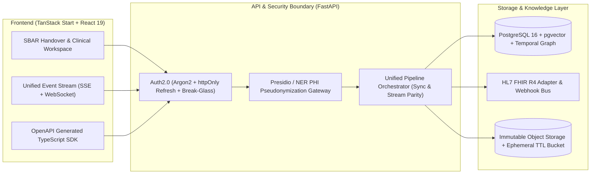

# 🏥 Hospital AI Knowledge Assistant — Comprehensive Audit, Repo-Scan, Team Orchestration & vNext Architecture Report

> **Generated Date:** 2026-11-10  
> **Frameworks Applied:** `/repo-scan` · `/systematic-debugging` · `/team-agent-orchestration`  
> **Perspectives:** QA/Tester · Solution Architect (SA) · Business Analyst (BA)  
> **Target Execution Branch:** `refactor/repo-clean-and-vnext-hardening` (Single-branch execution, **NO git worktree creation**)

---

## 1. `/repo-scan` — Cross-Stack Asset Audit & Four-Level Verdicts

### 1.1. Repository Surface Classification & Dead-Weight Inventory

| Path / Asset Group | Category | Size / Count | Verdict | Action Required |
|---|---|---:|---|---|
| `.review-d90d02f.tar`, `.review-archive-*`, `.review-prb-*` | Temp Review Archives | ~82+ MB | **Deprecate** | Delete from root and add `.review*` to `.gitignore` |
| `app/backend/venv`, `.venv`, `.venv-dev`, `.verify-pycache` | Local Build / Venv Clutter | 3 venvs + cache | **Deprecate** | Consolidate to single `.venv`; purge `.verify-pycache` & stale `cpython-39/311` `.pyc` files |
| `app/backend/scripts/stats.py`, `stats2.py` | Ad-hoc Scratch Scripts | 2 files (~2 KB) | **Deprecate** | Remove throwaway scripts from `app/backend/scripts/` |
| `app/backend/src/hospital_ai/rag_spike_adapter.py` | Spike Code in Prod `src/` | 1.5 KB | **Extract & Merge** | Move out of `src/hospital_ai/` into `tests/` or `.spikes/` |
| `Dockerfile.backend`, `docker-compose.prod.yml`, `task.md`, `HIRING_SIGNALS_ANALYSIS.md` | Root Config / Doc Clutter | 4 files | **Extract & Merge** | Reconcile with `app/backend/Dockerfile`, `infra/docker-compose.yml`, and `docs/` |
| `app/frontend/src/lib/api/example.functions.ts`, `src/lib/lovable-error-reporting.ts` | Scaffold Boilerplate | 2 files | **Deprecate** | Remove unused template scaffold files |
| `app/frontend/e2e/demo.cjs`, `discover.cjs`, `e2e/screenshots/page@*.webm` | Ad-hoc E2E Artifacts | 3 files | **Deprecate** | Remove ad-hoc `.cjs` scripts and random `.webm` artifact |
| `app/frontend/src/data/*.ts` (`ocrQueue.ts`, `syncJobs.ts`, `traces.ts`, `health.ts`, `conflicts.ts`) | Static Mock Data in Prod Routes | 9 files | **Rebuild** | Replace static imports in `_app.*` routes with live backend BFF API calls |
| Local Git Branches (`codex/*`, `pr/*`, `subagent-*`) | Git Hygiene | 90+ local branches | **Deprecate** | Prune merged/stale local branches violating `<type>/<kebab-case>` naming |
| `app/backend/src/hospital_ai/core/`, `db/`, `services/`, `api/` | Core Backend Pipeline | ~140 files | **Core Asset** | Retain, refactor high-CRAP functions, and fix P0 safety/contract bugs |
| `app/frontend/src/components/hms/`, `src/routes/`, `src/lib/` | Core Frontend Workspace | ~190 files | **Core Asset** | Retain, fix API client contracts, and wire remaining mock routes |

---

## 2. `/systematic-debugging` — Root Cause Analysis of Verified Defects (P0 / P1 / P2)

### 🔴 P0-1: API Contract Gate Blind Spot & Frontend API Client Bugs
- **Symptom:**
  1. `GET /api/v1/metrics/vector` returns `404 Not Found` when opening `/_app/integrations/vector-index`.
  2. `login()` in `app/frontend/src/lib/api/auth.ts` fails with `422 Unprocessable Entity` against `/api/v1/auth/token`.
  3. `sendMessage()` in `app/frontend/src/lib/api/chat.ts` drops `document_ids`.
  4. `python scripts/verify_contracts.py` reports `Detected 73 backend paths. Detected 6 frontend paths` and passes without catching any of the above.
- **Root Cause (Phase 1 & 2 Trace):**
  - `app/backend/scripts/verify_contracts.py` (lines 91–95) hardcodes `scan_files = ["src/lib/api-client.ts", "src/lib/auth-context.tsx", "src/lib/stream-client.ts"]` and never scans `app/frontend/src/lib/api/*.ts` (17 modules, 73 paths).
  - `app/frontend/src/lib/api/metrics.ts` (line 10) calls `apiFetch("/api/v1/metrics/vector")`. Because `apiFetch` already prepends `baseUrl` (`/api` or `http://localhost:8000/api/v1`), the request URL becomes `/api/api/v1/metrics/vector`.
  - `app/frontend/src/lib/api/auth.ts` (lines 20–25) sends JSON `{ email, password }`, whereas `app/backend/src/hospital_ai/api/routes/auth.py` (line 82) uses `OAuth2PasswordRequestForm` (`application/x-www-form-urlencoded` with `username`).
  - `app/frontend/src/lib/api/chat.ts` (lines 3–8) sends top-level `document_ids`, whereas `app/backend/src/hospital_ai/schemas/chat.py` (lines 9–21) expects `context: { document_ids }`.

### 🔴 P0-2: Autonomous CDSS Worker & Drug Check Stale-Generation / Scope Leakage
- **Symptom:**
  1. Re-indexing or soft-deleting a document causes `run_cdss_analysis` to feed superseded/deleted chunks and inactive graph entities to the LLM, generating duplicate `ClinicalAlert` rows without evidence grounding.
  2. `DrugCheckService.check_interactions` Step 1 surfaces relation assertions from superseded generations or unauthorized chunks.
- **Root Cause (Phase 1 & 2 Trace):**
  - `app/backend/src/hospital_ai/workers/cdss.py` (lines 28–44) queries `DocumentChunk`, `GraphEntity`, and `GraphRelationAssertion` without filtering `deleted_at.is_(None)`, `DocumentChunk.generation_id == document.active_index_generation_id`, or `GraphEntity.lifecycle_status == "active"`. Lines 100–129 insert `ClinicalAlert` rows without deduplicating existing alerts for `source_document_id`.
  - `app/backend/src/hospital_ai/services/drug_check.py` (lines 202–229) filters `patient_drug_entities` via `_filter_generation_valid_entities`, but then joins `GraphRelationAssertion` and `GraphRelationEvidence` without constraining `GraphRelationAssertion.lifecycle_status == "active"`, active generation on `GraphRelationEvidence`, or `_filter_generation_valid_entities` on `related_entity_ids` (`other_id`).

### 🔴 P0-3: Extreme Cyclomatic Complexity & Streaming Pipeline Parity Gap
- **Symptom:**
  - `calculate_crap_score.py` flags 119 functions exceeding `CRAP > 30.0`, led by `chat_stream` (`chat_stream.py:1027`, Complexity = 51, CRAP = 2159.4) and `ChatService.answer` (`chat.py:93`, Complexity = 63, CRAP = 288.8).
  - `/api/v1/chat/stream` hardcodes `pipeline = "simple_qa"` instead of supporting `decompose`, `patient_summary`, and `HyDE`.
- **Root Cause:**
  - Request disambiguation, permission verification, input guardrails, retrieval, GraphRAG enrichment, drug checking, and SSE generator creation are all inlined inside a single 500-line route handler in `chat_stream.py`.

### 🟠 P1: High-CRAP CDI V2 / Evaluation Modules & 0%-Covered Providers
- **Hotspots Identified by `calculate_crap_score.py`:**
  - `upload_sessions.py:161` (`create`: Comp 40, CRAP 1640.0)
  - `claim_validation.py:198` (`deterministic_entailment`: Comp 32, CRAP 1056.0)
  - `graph_rag.py:507` (`find_related_entities`: Comp 30, CRAP 930.0)
  - `runner.py:626` (`run_evaluation_async`: Comp 42, CRAP 786.2)
  - `documents.py:571` (`patch_review_item`: Comp 23, CRAP 552.0)
  - `timeline.py:28` (`get_global_timeline`: Comp 22, CRAP 506.0)
  - `clinical_timeline.py:32` (`document_timeline`: Comp 20, CRAP 420.0)
  - `generation_jobs.py:49` (`run`: Comp 20, CRAP 420.0)
  - `ocr.py:101` (`extract_pages`: Comp 20, CRAP 402.2)
- **Provider & Loader Coverage Gap:** `gemini_provider.py`, `openai_provider.py`, `ollama_provider.py`, `excel_loader.py`, and `html_loader.py` have `0%` unit coverage because tests only exercise `stub` and `deterministic` providers without `httpx.MockTransport` unit tests.
- **Sentinel Release Blocker:** All 50 cases in `app/backend/data/evaluation/rag_sentinel_v2.jsonl` remain `"status": "draft"` with `"reviewer_ids": []`.

### 🟡 P2: Frontend Router Hygiene, Static Mock Pages & Metrics Auth
- **TanStack Router Warnings:**
  - `app/frontend/src/routes/auth.sso.callback.test.ts` lacks the `-` ignore prefix (must be renamed to `-auth.sso.callback.test.ts`).
  - `app/frontend/src/routes/auth.sso.callback.tsx` exports `SsoCallback` directly from a route file, breaking code-splitting.
- **Static Mock Routes:** `_app.documents.ocr-queue.tsx`, `_app.documents.sync-hms.tsx`, `_app.integrations.hms.jobs.$jobId.tsx`, `_app.audit.traces.$traceId.tsx`, `_app.integrations.traces.$traceId.tsx`, and `SystemHealthCard.tsx` still import static arrays from `src/data/*`.
- **Metrics Endpoint Authorization:** `app/backend/src/hospital_ai/api/routes/metrics_endpoint.py` exposes `/api/v1/metrics` without auth and `/api/v1/metrics/vector` to any logged-in role without RBAC or patient-scope filtering.

---

## 3. `/team-agent-orchestration` — Agent Squad & Kanban Execution Plan

> **Branch Strategy:** Single feature/refactor branch `refactor/repo-clean-and-vnext-hardening` checked out directly in the current workspace (`worktree: "."`). No extra git worktrees.

| Card ID | Work Item Title | Owner Subagent | File Scope (Strict Non-Overlapping) | Merge Gate |
|---|---|---|---|---|
| `CARD-01` | **Repo Cleanup & Hygiene (`repo-scan`)** | `refactor-cleaner` | `.gitignore`, root clutter (`.review*`, `task.md`), `app/backend/scripts/stats*.py`, `rag_spike_adapter.py`, `app/frontend/src/lib/lovable-error-reporting.ts`, `example.functions.ts`, `-auth.sso.callback.test.ts` | `git status` clean of temp archives; `bun run build` & `vitest` emit zero router warnings |
| `CARD-02` | **API Contract Gate & Frontend Client Fixes** | `typescript-reviewer` / `frontend-agent` | `app/backend/scripts/verify_contracts.py`, `app/frontend/src/lib/api/metrics.ts`, `auth.ts`, `chat.ts`, `auth.sso.callback.tsx` | `python scripts/verify_contracts.py` scans all `src/lib/api/*.ts` (70+ paths) and exits `0` |
| `CARD-03` | **Clinical Safety: CDSS, Drug Check & Metrics RBAC** | `security-reviewer` / `backend-agent` | `app/backend/src/hospital_ai/workers/cdss.py`, `services/drug_check.py`, `api/routes/metrics_endpoint.py`, `tests/test_cdss_agent.py`, `tests/test_drug_check.py` | Active generation + `ActiveEvidenceScope` enforced; idempotent `ClinicalAlert`; pytest 100% green |
| `CARD-04` | **Decompose High-CRAP Functions & Stream Parity** | `python-reviewer` / `backend-refactor` | `app/backend/src/hospital_ai/api/routes/chat_stream.py`, `services/chat.py`, `services/upload_sessions.py`, `services/claim_validation.py` | `calculate_crap_score.py` shows `chat_stream` & `upload_sessions.create` complexity reduced < 20 |
| `CARD-05` | **Wire Frontend Mock Routes to Live BFF APIs** | `frontend-agent` | `app/frontend/src/routes/_app.documents.ocr-queue.tsx`, `_app.documents.sync-hms.tsx`, `_app.audit.traces.$traceId.tsx`, `SystemHealthCard.tsx` | Zero production imports from `src/data/{ocrQueue,syncJobs,traces,health}.ts`; Vitest tests pass |
| `CARD-06` | **Provider/Loader Unit Tests & CI E2E Expansion** | `tdd-guide` / `e2e-runner` | `app/backend/tests/`, `.github/workflows/ci.yml` | `pytest` coverage >= 80% on touched modules; `verify_deterministic_gates.py --mode smoke` passes |

---

## 4. Solution Architect (SA) & Business Analyst (BA) — vNext Product & Architecture Proposal

### 4.1. Business Analyst (BA) — Clinical Workflow Gaps & High-Value vNext Journeys

1. **Flow 1: Closed-Loop Clinical Alert Triage & Pharmacist Sign-Off (CDSS -> Pharmacy -> Order Override)**
   - **Current Gap:** `ClinicalAlert` records generated by `workers/cdss.py` and drug conflicts in `/_app/pharmacy/review-queue` are passive read-only notifications (`is_acknowledged` boolean only). Clinicians cannot record *why* an alert was overridden, request a pharmacist consult, or link an acknowledgment to an audit trail.
   - **vNext BA Requirement:** Introduce a structured **Alert Lifecycle State Machine** (`open` -> `under_review` -> `accepted_intervention` | `overridden_with_justification` | `false_positive`) with mandatory clinical reason codes, dual sign-off for `critical` contraindications, and automatic feedback loop into the AI Evaluation dataset.

2. **Flow 2: Shift Handover & Multidisciplinary Clinical SBAR Summary (IPASS / SBAR Copilot)**
   - **Current Gap:** Doctors and nurses use free-form chat (`/chat`) or view raw timelines, but hospital shift changes require standardized **SBAR (Situation, Background, Assessment, Recommendation)** or **IPASS** handoffs scoped to the last 12/24 hours.
   - **vNext BA Requirement:** Dedicated **Shift Handover Generator** workflow on the Patient Overview page that synthesizes delta changes (new labs, medication changes, unresolved CDSS alerts, pending OCR reviews) over a selectable time window (`Last 8h / 24h / Since Admission`), with 100% inline sentence-level citations and one-click export to PDF/FHIR Composition.

3. **Flow 3: Break-Glass Emergency Access with Post-Hoc Compliance Review**
   - **Current Gap:** When a clinician lacks patient scope, `/access-requests` requires synchronous admin approval. In emergency care (code blue / ICU cross-cover), waiting for manual approval delays care, while `BreakGlassDialog.tsx` is currently disabled/stubbed (`ENABLE_BREAK_GLASS=false`).
   - **vNext BA Requirement:** Implement **Time-Bounded Break-Glass Access** (e.g., 4-hour emergency grant) requiring structured clinical justification + witness ID, triggering an immediate high-priority compliance ticket for `security`/`admin` roles in `/_app/audit/denied` and `/_app/access-requests`.

4. **Flow 4: Ephemeral Session-Scoped Consult Attachments ("Sandbox Clinical Second Opinion")**
   - **Current Gap:** Every uploaded document enters the permanent patient knowledge base. Clinicians frequently want to drop a referral letter, external lab PDF, or clinical guideline into a chat thread for temporary cross-checking without polluting the permanent EMR index.
   - **vNext BA Requirement:** Support `scope = "thread_ephemeral"` uploads with TTL auto-purge when the chat thread is archived/deleted.

---

### 4.2. Solution Architect (SA) — Technical Evolution Blueprint (vNext Architecture)

1. **Unified RAG Pipeline Orchestrator (Eliminating `/chat` vs `/chat/stream` Drift):**
   - Replace the duplicated orchestration in `chat.py` and `chat_stream.py` with a single **Async Event-Driven Pipeline (`RagExecutionEngine`)** that yields typed domain events (`PatientResolved`, `GuardrailPassed`, `EvidenceRetrieved`, `GraphEnriched`, `DrugWarningsComputed`, `SentenceValidated`, `StreamCompleted`).
   - Both `POST /api/v1/chat` (collects final state) and `POST /api/v1/chat/stream` (streams SSE events) consume the exact same generator, guaranteeing 100% feature parity (`decompose`, `patient_summary`, `HyDE`, and safety contracts).

2. **Schema-First Contract Generation (Replacing Regex `verify_contracts.py`):**
   - Export FastAPI's `openapi.json` at build/test time and generate strongly-typed TypeScript clients (`openapi-typescript` / `@hey-api/openapi-ts`), eliminating manual path/schema drift between `app/backend/src/hospital_ai/schemas/` and `app/frontend/src/lib/api/`.

3. **Bi-Temporal Clinical Knowledge Graph (`valid_time` vs `transaction_time`):**
   - Upgrade `GraphRelationAssertion` in `clinical_graph.py` with explicit bi-temporal columns (`clinical_effective_from`, `clinical_effective_to`, `recorded_at`, `superseded_by_generation_id`) so the RAG engine can accurately answer temporal clinical questions (e.g., *"What was the patient's eGFR before Lisinopril was started?"*) without conflating historical and current states.

4. **Dual-Track PHI Redaction & Local/Cloud Hybrid Routing:**
   - Insert a deterministic + NER (Microsoft Presidio / spaCy) **PHI Scrubbing Middleware** before external LLM/Embedding calls (`gemini`, `openai`), replacing patient identifiers with session-scoped tokens (`[PATIENT_01]`, `[MRN_REDACTED]`) and re-hydrating them only inside the authorized hospital boundary.
   - Route high-sensitivity PHI summarization to local `Ollama`/`vLLM` while allowing de-identified medical reasoning to use cloud frontier models under policy control.
