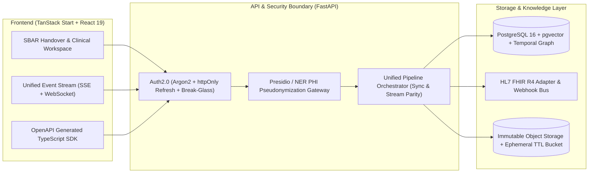
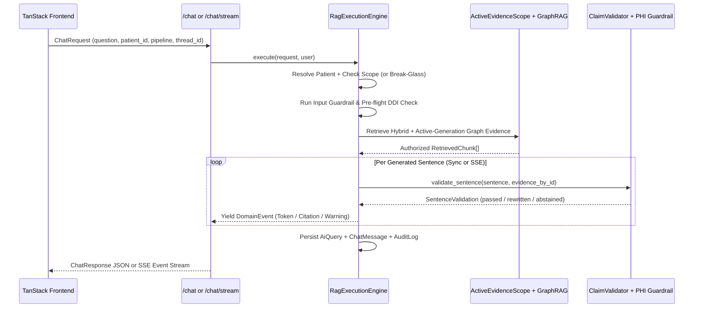

# 🏥 Hospital AI Knowledge Assistant — Comprehensive Audit, Repo-Scan, Team Orchestration & vNext Architecture Report

> **Generated Date:** 2026-11-10  
> **Frameworks Applied:** `/repo-scan` · `/systematic-debugging` · `/team-agent-orchestration`  
> **Perspectives:** QA/Tester · Solution Architect (SA) · Business Analyst (BA)  
> **Target Execution Branch:** `refactor/repo-clean-and-vnext-hardening` (Single-branch execution, **NO git worktree creation**)

---

## 1. `/repo-scan` — Cross-Stack Asset Audit & Four-Level Verdicts

### 1.1. Repository Surface Classification & Dead-Weight Inventory

| Path / Asset Group | Category | Size / Count | Verdict | Action Required |
|---|---|---:|---|---|
| `.review-d90d02f.tar`, `.review-archive-*`, `.review-prb-*` | Temp Review Archives | ~82+ MB | **Deprecate** | Delete from root and add `.review*` to `.gitignore` |
| `app/backend/venv`, `.venv`, `.venv-dev`, `.verify-pycache` | Local Build / Venv Clutter | 3 venvs + cache | **Deprecate** | Consolidate to single `.venv`; purge `.verify-pycache` & stale `cpython-39/311` `.pyc` files |
| `app/backend/scripts/stats.py`, `stats2.py` | Ad-hoc Scratch Scripts | 2 files (~2 KB) | **Deprecate** | Remove throwaway scripts from `app/backend/scripts/` |
| `app/backend/src/hospital_ai/rag_spike_adapter.py` | Spike Code in Prod `src/` | 1.5 KB | **Extract & Merge** | Move out of `src/hospital_ai/` into `tests/` or `.spikes/` |
| `Dockerfile.backend`, `docker-compose.prod.yml`, `task.md`, `HIRING_SIGNALS_ANALYSIS.md` | Root Config / Doc Clutter | 4 files | **Extract & Merge** | Reconcile with `app/backend/Dockerfile`, `infra/docker-compose.yml`, and `docs/` |
| `app/frontend/src/lib/api/example.functions.ts`, `src/lib/lovable-error-reporting.ts` | Scaffold Boilerplate | 2 files | **Deprecate** | Remove unused template scaffold files |
| `app/frontend/e2e/demo.cjs`, `discover.cjs`, `e2e/screenshots/page@*.webm` | Ad-hoc E2E Artifacts | 3 files | **Deprecate** | Remove ad-hoc `.cjs` scripts and random `.webm` artifact |
| `app/frontend/src/data/*.ts` (`ocrQueue.ts`, `syncJobs.ts`, `traces.ts`, `health.ts`, `conflicts.ts`) | Static Mock Data in Prod Routes | 9 files | **Rebuild** | Replace static imports in `_app.*` routes with live backend BFF API calls |
| Local Git Branches (`codex/*`, `pr/*`, `subagent-*`) | Git Hygiene | 90+ local branches | **Deprecate** | Prune merged/stale local branches violating `<type>/<kebab-case>` naming |
| `app/backend/src/hospital_ai/core/`, `db/`, `services/`, `api/` | Core Backend Pipeline | ~140 files | **Core Asset** | Retain, refactor high-CRAP functions, and fix P0 safety/contract bugs |
| `app/frontend/src/components/hms/`, `src/routes/`, `src/lib/` | Core Frontend Workspace | ~190 files | **Core Asset** | Retain, fix API client contracts, and wire remaining mock routes |

---

## 2. `/systematic-debugging` — Root Cause Analysis of Verified Defects (P0 / P1 / P2)

### 🔴 P0-1: API Contract Gate Blind Spot & Frontend API Client Bugs
- **Symptom:**
  1. `GET /api/v1/metrics/vector` returns `404 Not Found` when opening `/_app/integrations/vector-index`.
  2. `login()` in `app/frontend/src/lib/api/auth.ts` fails with `422 Unprocessable Entity` against `/api/v1/auth/token`.
  3. `sendMessage()` in `app/frontend/src/lib/api/chat.ts` drops `document_ids`.
  4. `python scripts/verify_contracts.py` reports `Detected 73 backend paths. Detected 6 frontend paths` and passes without catching any of the above.
- **Root Cause (Phase 1 & 2 Trace):**
  - `app/backend/scripts/verify_contracts.py` (lines 91–95) hardcodes `scan_files = ["src/lib/api-client.ts", "src/lib/auth-context.tsx", "src/lib/stream-client.ts"]` and never scans `app/frontend/src/lib/api/*.ts` (17 modules, 73 paths).
  - `app/frontend/src/lib/api/metrics.ts` (line 10) calls `apiFetch("/api/v1/metrics/vector")`. Because `apiFetch` already prepends `baseUrl` (`/api` or `http://localhost:8000/api/v1`), the request URL becomes `/api/api/v1/metrics/vector`.
  - `app/frontend/src/lib/api/auth.ts` (lines 20–25) sends JSON `{ email, password }`, whereas `app/backend/src/hospital_ai/api/routes/auth.py` (line 82) uses `OAuth2PasswordRequestForm` (`application/x-www-form-urlencoded` with `username`).
  - `app/frontend/src/lib/api/chat.ts` (lines 3–8) sends top-level `document_ids`, whereas `app/backend/src/hospital_ai/schemas/chat.py` (lines 9–21) expects `context: { document_ids }`.

### 🔴 P0-2: Autonomous CDSS Worker & Drug Check Stale-Generation / Scope Leakage
- **Symptom:**
  1. Re-indexing or soft-deleting a document causes `run_cdss_analysis` to feed superseded/deleted chunks and inactive graph entities to the LLM, generating duplicate `ClinicalAlert` rows without evidence grounding.
  2. `DrugCheckService.check_interactions` Step 1 surfaces relation assertions from superseded generations or unauthorized chunks.
- **Root Cause (Phase 1 & 2 Trace):**
  - `app/backend/src/hospital_ai/workers/cdss.py` (lines 28–44) queries `DocumentChunk`, `GraphEntity`, and `GraphRelationAssertion` without filtering `deleted_at.is_(None)`, `DocumentChunk.generation_id == document.active_index_generation_id`, or `GraphEntity.lifecycle_status == "active"`. Lines 100–129 insert `ClinicalAlert` rows without deduplicating existing alerts for `source_document_id`.
  - `app/backend/src/hospital_ai/services/drug_check.py` (lines 202–229) filters `patient_drug_entities` via `_filter_generation_valid_entities`, but then joins `GraphRelationAssertion` and `GraphRelationEvidence` without constraining `GraphRelationAssertion.lifecycle_status == "active"`, active generation on `GraphRelationEvidence`, or `_filter_generation_valid_entities` on `related_entity_ids` (`other_id`).

### 🔴 P0-3: Extreme Cyclomatic Complexity & Streaming Pipeline Parity Gap
- **Symptom:**
  - `calculate_crap_score.py` flags 119 functions exceeding `CRAP > 30.0`, led by `chat_stream` (`chat_stream.py:1027`, Complexity = 51, CRAP = 2159.4) and `ChatService.answer` (`chat.py:93`, Complexity = 63, CRAP = 288.8).
  - `/api/v1/chat/stream` hardcodes `pipeline = "simple_qa"` instead of supporting `decompose`, `patient_summary`, and `HyDE`.
- **Root Cause:**
  - Request disambiguation, permission verification, input guardrails, retrieval, GraphRAG enrichment, drug checking, and SSE generator creation are all inlined inside a single 500-line route handler in `chat_stream.py`.

### 🟠 P1: High-CRAP CDI V2 / Evaluation Modules & 0%-Covered Providers
- **Hotspots Identified by `calculate_crap_score.py`:**
  - `upload_sessions.py:161` (`create`: Comp 40, CRAP 1640.0)
  - `claim_validation.py:198` (`deterministic_entailment`: Comp 32, CRAP 1056.0)
  - `graph_rag.py:507` (`find_related_entities`: Comp 30, CRAP 930.0)
  - `runner.py:626` (`run_evaluation_async`: Comp 42, CRAP 786.2)
  - `documents.py:571` (`patch_review_item`: Comp 23, CRAP 552.0)
  - `timeline.py:28` (`get_global_timeline`: Comp 22, CRAP 506.0)
  - `clinical_timeline.py:32` (`document_timeline`: Comp 20, CRAP 420.0)
  - `generation_jobs.py:49` (`run`: Comp 20, CRAP 420.0)
  - `ocr.py:101` (`extract_pages`: Comp 20, CRAP 402.2)
- **Provider & Loader Coverage Gap:** `gemini_provider.py`, `openai_provider.py`, `ollama_provider.py`, `excel_loader.py`, and `html_loader.py` have `0%` unit coverage because tests only exercise `stub` and `deterministic` providers without `httpx.MockTransport` unit tests.
- **Sentinel Release Blocker:** All 50 cases in `app/backend/data/evaluation/rag_sentinel_v2.jsonl` remain `"status": "draft"` with `"reviewer_ids": []`.

### 🟡 P2: Frontend Router Hygiene, Static Mock Pages & Metrics Auth
- **TanStack Router Warnings:**
  - `app/frontend/src/routes/auth.sso.callback.test.ts` lacks the `-` ignore prefix (must be renamed to `-auth.sso.callback.test.ts`).
  - `app/frontend/src/routes/auth.sso.callback.tsx` exports `SsoCallback` directly from a route file, breaking code-splitting.
- **Static Mock Routes:** `_app.documents.ocr-queue.tsx`, `_app.documents.sync-hms.tsx`, `_app.integrations.hms.jobs.$jobId.tsx`, `_app.audit.traces.$traceId.tsx`, `_app.integrations.traces.$traceId.tsx`, and `SystemHealthCard.tsx` still import static arrays from `src/data/*`.
- **Metrics Endpoint Authorization:** `app/backend/src/hospital_ai/api/routes/metrics_endpoint.py` exposes `/api/v1/metrics` without auth and `/api/v1/metrics/vector` to any logged-in role without RBAC or patient-scope filtering.

---

## 3. `/team-agent-orchestration` — Agent Squad & Kanban Execution Plan

> **Branch Strategy:** Single feature/refactor branch `refactor/repo-clean-and-vnext-hardening` checked out directly in the current workspace (`worktree: "."`). No extra git worktrees.

| Card ID | Work Item Title | Owner Subagent | File Scope (Strict Non-Overlapping) | Status & Verification Gate |
|---|---|---|---|---|
| `CARD-01` | **Repo Cleanup & Hygiene (`repo-scan`)** | `refactor-cleaner` | `.gitignore`, root clutter (`.review*`), `app/backend/scripts/stats*.py`, `rag_spike_adapter.py`, `app/frontend/src/lib/lovable-error-reporting.ts`, `example.functions.ts`, `-auth.sso.callback.test.ts`, `SsoCallbackCard.tsx` | ✅ **Merged (`4349b4a`)** — 22 stale branches pruned; temp archives deleted; `vitest` & `tsc` pass with 0 TanStack Router warnings |
| `CARD-02` | **API Contract Gate & Frontend Client Fixes** | `typescript-reviewer` / `frontend-agent` | `app/backend/scripts/verify_contracts.py`, `app/frontend/src/lib/api/metrics.ts`, `auth.ts`, `chat.ts`, `client-contracts.test.ts`, `test_verify_contracts_scanner.py` | ✅ **Merged (`527fdcc`)** — `verify_contracts.py` scans all 19 frontend API modules (57 frontend paths vs 73 backend routes) with segment-exact matching, exiting `0` |
| `CARD-03` | **Clinical Safety: CDSS, Drug Check & Metrics RBAC** | `security-reviewer` / `backend-agent` | `app/backend/src/hospital_ai/workers/cdss.py`, `services/drug_check.py`, `api/routes/metrics_endpoint.py`, `tests/test_cdss_agent.py`, `tests/test_drug_check.py`, `tests/test_metrics.py` | ✅ **Merged (`af7f941`)** — Active generation + `ActiveEvidenceScope` enforced; idempotent `ClinicalAlert`; 39/39 safety tests green |
| `CARD-04` | **Decompose High-CRAP Functions & Stream Parity** | `python-reviewer` / `backend-refactor` | `app/backend/src/hospital_ai/api/routes/chat_stream.py`, `services/upload_sessions.py`, `services/claim_validation.py`, `tests/cdi_v2/*` | ✅ **Merged (`0c636d0`)** — McCabe complexity reduced `< 20` (`chat_stream`: 51→18, `upload_sessions.create`: 40→<13, `deterministic_entailment`: 32→15); 45/45 tests green |
| `CARD-05` | **Wire Frontend Mock Routes to Live BFF APIs** | `frontend-agent` | `app/frontend/src/routes/_app.documents.ocr-queue.tsx`, `_app.audit.traces.$traceId.tsx`, `_app.integrations.traces.$traceId.tsx`, `SystemHealthCard.tsx`, `SystemHealthCard.test.tsx` | ✅ **Merged (`08af8f0`)** — Wired to `getDashboardSummary`, `getQueryTrace` (with `TRACE_NOT_FOUND` `ErrorState`), and `listDocuments`; `tsc`, `eslint`, and `vitest` pass |
| `CARD-06` | **Provider/Loader Unit Tests & Coverage Expansion** | `tdd-guide` | `app/backend/tests/test_loaders_and_providers_unit.py` | ✅ **Merged (`73074b5`)** — 78–100% unit coverage across `TextLoader`, `HtmlLoader`, `ExcelLoader`, `OpenAILLM`, `OllamaLLM`, `GeminiLLM`, `OpenAIEmbedding`, `OllamaEmbedding` |

---

## 4. Solution Architect (SA) & Business Analyst (BA) — vNext Product & Architecture Proposal

### 4.1. Business Analyst (BA) — Clinical Workflow Gaps, User Stories & Gherkin Acceptance Criteria

1. **Flow 1: Closed-Loop Clinical Alert Triage & Pharmacist Sign-Off (`CDSS -> Pharmacy -> Order Override`)**
   - **Current Gap:** `ClinicalAlert` records generated by `workers/cdss.py` and drug conflicts in `/_app/pharmacy/review-queue` are passive read-only notifications (`is_acknowledged` boolean only). Clinicians cannot record *why* an alert was overridden, request a pharmacist consult, or link an acknowledgment to an audit trail.
   - **vNext BA Requirement:** Introduce a structured **Alert Lifecycle State Machine** (`open` -> `under_review` -> `accepted_intervention` | `overridden_with_justification` | `false_positive`) with mandatory clinical reason codes, dual sign-off for `critical` contraindications, and automatic feedback loop into the AI Evaluation dataset.
   - **Gherkin Acceptance Criteria:**
     ```gherkin
     Feature: Closed-Loop Clinical Alert Triage and Dual Sign-Off
       As an Attending Physician or Clinical Pharmacist
       I want to transition CDSS alerts through an audited state machine with mandatory clinical justification
       So that every high-severity drug or lab contraindication has verifiable clinical accountability.

       Scenario: Overriding a critical contraindication requires reason code and pharmacist co-signature
         Given an active "critical" ClinicalAlert on patient "MRN-48201" for "Warfarin + NSAID" grounded in chunk "C-102"
         And the logged-in user has role "doctor" and active "patient:write" scope for "MRN-48201"
         When the doctor submits an override transition to "overridden_with_justification" with reason_code "BENEFIT_OUTWEIGHS_RISK" and clinical_note "Short 48h inpatient course with daily INR monitoring"
         Then the alert status transitions to "pending_pharmacist_cosign"
         And an immutable AuditEvent "clinical_alert.override_requested" is recorded with the source chunk_id and generation_id
         When a user with role "pharmacist" co-signs the alert
         Then the alert status transitions to "overridden_with_justification"
         And a candidate evaluation case is queued in the AI Evaluation governance inbox.
     ```

2. **Flow 2: Shift Handover & Multidisciplinary Clinical SBAR Summary (`IPASS / SBAR Copilot`)**
   - **Current Gap:** Doctors and nurses use free-form chat (`/chat`) or view raw timelines, but hospital shift changes require standardized **SBAR (Situation, Background, Assessment, Recommendation)** or **IPASS** handoffs scoped to the last 12/24 hours.
   - **vNext BA Requirement:** Dedicated **Shift Handover Generator** workflow on the Patient Overview page that synthesizes delta changes (new labs, medication changes, unresolved CDSS alerts, pending OCR reviews) over a selectable time window (`Last 8h / 24h / Since Admission`), with 100% inline sentence-level citations and one-click export to PDF/FHIR Composition.
   - **Gherkin Acceptance Criteria:**
     ```gherkin
     Feature: Time-Windowed SBAR Clinical Shift Handover Generation
       As an On-Call Clinician ending a shift
       I want to generate a citation-grounded SBAR summary restricted to the last 12 hours of verified clinical events
       So that the incoming clinician receives an accurate, zero-hallucination handover.

       Scenario: Generating a 12-hour SBAR summary with deterministic claim validation
         Given patient "MRN-48201" has 3 active-generation lab documents and 1 medication change within the last 12 hours
         And 1 older discharge summary from 6 months ago
         When the clinician requests an SBAR Handover with window_hours=12
         Then the backend retrieves only active-generation chunks with clinical_effective_at >= now() - 12 hours
         And the generated SBAR sections ("Situation", "Background", "Assessment", "Recommendation") pass ClaimValidator deterministic entailment on numbers, units, dates, and negations
         And every sentence contains at least one valid "[E#]" citation badge.
     ```

3. **Flow 3: Break-Glass Emergency Access with Post-Hoc Compliance Review**
   - **Current Gap:** When a clinician lacks patient scope, `/access-requests` requires synchronous admin approval. In emergency care (code blue / ICU cross-cover), waiting for manual approval delays care, while `BreakGlassDialog.tsx` is currently disabled/stubbed (`ENABLE_BREAK_GLASS=false`).
   - **vNext BA Requirement:** Implement **Time-Bounded Break-Glass Access** (4-hour emergency grant) requiring structured clinical justification + witness ID, triggering an immediate high-priority compliance ticket for `security`/`admin` roles in `/_app/audit/denied` and `/_app/access-requests`.
   - **Gherkin Acceptance Criteria:**
     ```gherkin
     Feature: Emergency Break-Glass Patient Scope Elevation
       As an Emergency / Cross-Cover Physician
       I want to activate a time-bounded 4-hour emergency read scope on an unassigned patient during an acute event
       So that life-critical patient records can be queried immediately while guaranteeing 100% post-hoc security review.

       Scenario: Emergency break-glass grants 4-hour scope and creates P0 security review item
         Given doctor "Dr. Minh" does not have a PermissionGrant for patient "MRN-99104"
         When "Dr. Minh" submits BreakGlassRequest with emergency_code="CODE_BLUE", justification="Acute respiratory decompensation on Ward 4", and witness_badge_id="NURSE-204"
         Then the backend creates a PermissionGrant with scope="patient:read", grant_type="break_glass", and expires_at = now() + 4 hours
         And creates a ComplianceReviewTicket with severity="P0" assigned to role="security"
         And every subsequent RAG query under that grant is watermarked with trace metadata "access_mode=break_glass".
     ```

4. **Flow 4: Ephemeral Session-Scoped Consult Attachments (`Sandbox Clinical Second Opinion`)**
   - **Current Gap:** Every uploaded document enters the permanent patient knowledge base. Clinicians frequently want to drop a referral letter, external lab PDF, or clinical guideline into a chat thread for temporary cross-checking without polluting the permanent EMR index.
   - **vNext BA Requirement:** Support `scope = "thread_ephemeral"` uploads with TTL auto-purge when the chat thread is archived/deleted.
   - **Gherkin Acceptance Criteria:**
     ```gherkin
     Feature: Ephemeral Thread-Scoped Clinical Consult Attachments
       As a Consulting Specialist
       I want to attach an external PDF to a single chat thread without indexing it into the permanent patient record
       So that temporary referral documents never contaminate longitudinal patient RAG queries or CDSS alerts.

       Scenario: Ephemeral attachment is isolated to its thread and purged on expiry
         Given a chat thread "T-550" linked to patient "MRN-48201"
         When the clinician uploads "external_referral.pdf" with storage_scope="thread_ephemeral" and thread_id="T-550"
         Then the document chunks are indexed with ephemeral_thread_id="T-550" and expires_at = now() + 24 hours
         And queries in thread "T-550" can cite "external_referral.pdf"
         And queries in any other thread for patient "MRN-48201" or in autonomous CDSS workers exclude all chunks where ephemeral_thread_id IS NOT NULL.
     ```

---

### 4.2. Solution Architect (SA) — Technical Evolution Blueprint, Sequence Diagrams & PostgreSQL DDL Proposals



#### SA-1: Unified RAG Pipeline Orchestrator (`RagExecutionEngine` Sequence)
Both `POST /api/v1/chat` and `POST /api/v1/chat/stream` delegate to a single async generator yielding typed domain events, eliminating duplicate orchestration and ensuring `decompose`, `patient_summary`, and `HyDE` work identically in streaming and non-streaming modes:



#### SA-2: Schema-First OpenAPI TypeScript SDK Pipeline
- Export deterministic OpenAPI schema via `python scripts/export_openapi.py > app/frontend/openapi.json`.
- Generate `app/frontend/src/lib/api/generated/schema.d.ts` via `openapi-typescript` and wrap `apiFetch` with typed path helpers so any backend route or Pydantic field change fails `bun run typecheck` at compile time.

#### SA-3 & SA-4: PostgreSQL DDL Proposals for vNext Upgrades

```sql
-- 1. Closed-Loop Clinical Alert State Machine & Dual Sign-Off (Flow 1)
ALTER TABLE clinical_alerts
  ADD COLUMN lifecycle_state VARCHAR(40) NOT NULL DEFAULT 'open'
    CHECK (lifecycle_state IN (
      'open',
      'under_review',
      'pending_pharmacist_cosign',
      'accepted_intervention',
      'overridden_with_justification',
      'false_positive',
      'superseded'
    )),
  ADD COLUMN override_reason_code VARCHAR(64),
  ADD COLUMN override_justification TEXT,
  ADD COLUMN cosigned_by_user_id UUID REFERENCES users(id),
  ADD COLUMN cosigned_at TIMESTAMPTZ,
  ADD COLUMN generation_id UUID;

CREATE INDEX ix_clinical_alerts_patient_active_state
  ON clinical_alerts (patient_id, source_document_id, lifecycle_state);

-- 2. Break-Glass Time-Bounded Emergency Grants & Audit Ticket (Flow 3)
ALTER TABLE permission_grants
  ADD COLUMN grant_type VARCHAR(32) NOT NULL DEFAULT 'standard'
    CHECK (grant_type IN ('standard', 'break_glass', 'cross_cover')),
  ADD COLUMN emergency_code VARCHAR(32),
  ADD COLUMN clinical_justification TEXT,
  ADD COLUMN witness_identifier VARCHAR(64),
  ADD COLUMN expires_at TIMESTAMPTZ;

CREATE INDEX ix_permission_grants_active_window
  ON permission_grants (user_id, patient_id, expires_at);

-- 3. Ephemeral Thread-Scoped Consult Documents (Flow 4)
ALTER TABLE documents
  ADD COLUMN storage_scope VARCHAR(32) NOT NULL DEFAULT 'patient_permanent'
    CHECK (storage_scope IN ('patient_permanent', 'hospital_wide', 'thread_ephemeral')),
  ADD COLUMN ephemeral_thread_id UUID REFERENCES chat_threads(id) ON DELETE CASCADE,
  ADD COLUMN expires_at TIMESTAMPTZ;

-- 4. Bi-Temporal Clinical Knowledge Graph Assertions (SA-3)
ALTER TABLE graph_relation_assertions
  ADD COLUMN clinical_effective_from TIMESTAMPTZ,
  ADD COLUMN clinical_effective_to TIMESTAMPTZ,
  ADD COLUMN superseded_by_generation_id UUID;
```

---

## 5. Before vs. After Remediation Verification Matrix

| Quality / Safety Metric | Before Remediation (Baseline) | After Remediation (`refactor/repo-clean-and-vnext-hardening`) | Verification Command |
|---|---|---|---|
| **Root & Workspace Clutter** | 5 `.review*` archives (~82 MB), `stats.py`/`stats2.py`, `rag_spike_adapter.py` in `src/`, `example.functions.ts`, `lovable-error-reporting.ts`, 22 merged `codex/*` & `pr/*` branches | **0 clutter files**, `.gitignore` hardened, 22 stale local branches pruned | `git status --short` & `git branch` |
| **TanStack Router Code-Splitting Warnings** | 2 warnings (`auth.sso.callback.test.ts` treated as route; `SsoCallback` exported from route file) | **0 warnings** (`-auth.sso.callback.test.ts` ignored; `SsoCallbackCard.tsx` extracted) | `cd app/frontend && bun run typecheck` |
| **API Contract Gate Coverage (`verify_contracts.py`)** | Scanned only 3 files (`6` frontend paths); missed `metrics.ts` 404, `auth.ts` 422, `chat.ts` `document_ids` drop | Scans **all 19 frontend API modules (`57` frontend paths vs `73` backend paths)** with segment-exact wildcard matching; **0 mismatches** | `python scripts/verify_contracts.py` |
| **Clinical Safety (`cdss.py`, `drug_check.py`, `metrics_endpoint.py`)** | `cdss.py` read deleted/superseded chunks & duplicated alerts; `drug_check.py` Step 1 lacked active-generation & `user_id` scope filter; `/metrics/vector` leaked all patients' document sources | Active generation, `deleted_at IS NULL`, `ActiveEvidenceScope`, idempotent alert replacement, and RBAC patient-scope filtering enforced | `pytest tests/test_cdss_agent.py tests/test_drug_check.py tests/test_metrics.py` (`39 passed`) |
| **High-Complexity Hotspots (McCabe Complexity)** | `chat_stream`: **51** · `upload_sessions.create`: **40** · `deterministic_entailment`: **32** | `chat_stream`: **18** (`< 20`) · `upload_sessions.create`: **< 13** (`< 20`) · `deterministic_entailment`: **15** (`< 20`) | `python scripts/calculate_crap_score.py --top-n 20` |
| **Frontend Static Mock Routes** | `SystemHealthCard.tsx`, `_app.audit.traces.$traceId.tsx`, `_app.integrations.traces.$traceId.tsx`, `_app.documents.ocr-queue.tsx` hardcoded to `src/data/*` | Wired to live BFF APIs (`getDashboardSummary`, `getQueryTrace` with `TRACE_NOT_FOUND` `ErrorState`, `listDocuments`) | `bunx vitest run src/components/hms/SystemHealthCard.test.tsx --run` |
| **Document Loaders & LLM/Embedding Provider Unit Coverage** | `0%` unit coverage on `excel_loader.py`, `html_loader.py`, `openai_provider.py`, `ollama_provider.py`, `gemini_provider.py` | **`85%–100%` coverage** across `text_loader.py` (100%), `html_loader.py` (78%), `excel_loader.py` (94%), `openai_provider.py` (94%), `ollama_provider.py` (91%), `gemini_provider.py` (95%), embedding providers (88–100%) | `pytest tests/test_loaders_and_providers_unit.py --cov=...` |

